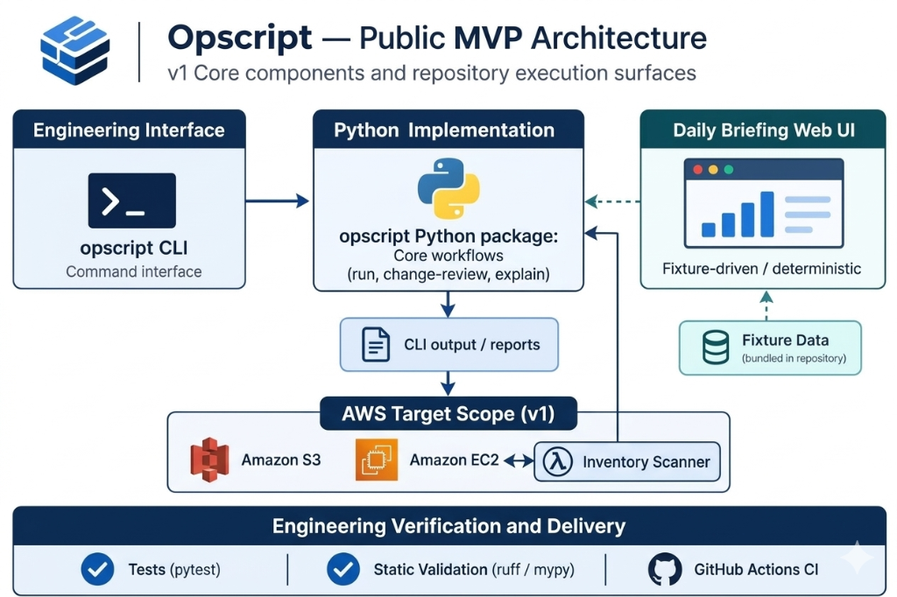

# Opscript

Opscript helps engineers understand how AWS infrastructure changes over time.

It collects AWS infrastructure snapshots, compares historical state, and produces structured observations, findings, and review reports that can be inspected locally through a command-line interface.

The Daily Briefing web interface provides the fastest deterministic product demonstration. It uses bundled fixture data, so an evaluator can inspect the reporting experience without AWS credentials or hosted services.

Opscript modularly orchestrates application workflows, infrstructure integrations, local data storage nd deterministic data presentation.

## Architecture



## What Opscript Does

Opscript supports:

- Collecting AWS infrastructure inventory.
- Comparing historical infrastructure snapshots.
- Producing structured operational review reports.
- Exploring infrastructure and resource history.
- Reviewing change patterns over time.
- Running deterministic local demonstrations and validation.

## Current Capabilities

### Infrastructure Discovery

- AWS inventory collection.

### Infrastructure Review

- `run`
- `change-review`
- `explain`

### Historical Analysis

- `inventory-history`
- `resource-evolution`
- `environment-evolution`
- `metadata-grouping`
- `observation-history`

### Change Pattern Analysis

- `instability`
- `stability`
- `activity`
- `change-frequency`
- `churn`
- `cross-scope-activity`

### Knowledge Review

- `knowledge-review`

### System Utilities

- `health`
- `version`

### Web Interface

- Daily Briefing demonstration using bundled fixture data.

## Recommended Evaluation Path

Start with the local CLI checks, then use the Daily Briefing frontend as the representative product demonstration:

```powershell
uv sync --all-groups
uv run opscript --help
uv run opscript version
uv run opscript health

cd web
npm ci
npm run dev
```

The CLI commands verify installation, command discovery, version output, and local runtime composition. The frontend opens a deterministic Daily Briefing review that demonstrates the reporting experience without live cloud infrastructure.

## Prerequisites

- Python 3.12 or newer
- `uv`
- Node.js 20 and npm
- AWS credentials, only for optional live inventory collection

## Installation

Run these commands from the repository root:

```powershell
git clone https://github.com/opscript-labs/opscript.git
cd opscript
uv sync --all-groups

cd web
npm ci
cd ..
```

## Running the CLI

Display available commands:

```powershell
uv run opscript --help
```

Basic validation:

```powershell
uv run opscript version
uv run opscript health
```

Optional AWS-backed workflows:

```powershell
uv run opscript inventory
uv run opscript change-review
uv run opscript environment-evolution
```

Run these commands only with tester-owned AWS credentials or tester-owned persistent snapshot history.

Most commands also support JSON output:

```powershell
uv run opscript --json version
```

## Configuration

For local evaluation, the default configuration uses development mode with in-memory storage.

```powershell
$env:OPSCRIPT_ENVIRONMENT = "dev"
$env:OPSCRIPT_STORAGE_BACKEND = "memory"
$env:OPSCRIPT_DISCOVERY_SCOPE = "tester-sandbox"
```

To evaluate historical analysis using persistent snapshots, configure your own non-production S3 bucket:

```powershell
$env:OPSCRIPT_STORAGE_BACKEND = "s3"
$env:OPSCRIPT_S3_BUCKET = "<your-test-bucket>"
$env:OPSCRIPT_S3_KEY = "<your-safe-prefix>/snapshots"
```

Optional AWS SDK timeout settings:

```powershell
$env:OPSCRIPT_AWS_CONNECT_TIMEOUT = "2"
$env:OPSCRIPT_AWS_READ_TIMEOUT = "10"
$env:OPSCRIPT_AWS_SDK_TOTAL_MAX_ATTEMPTS = "1"
```

## Running the Web Interface

Launch the Daily Briefing demonstration from `web/`:

```powershell
cd web
npm run dev
```

## Validation

Python:

```powershell
uv sync --all-groups
uv run pytest
uv run ruff check .
uv run ruff format --check .
```

Frontend:

```powershell
cd web
npm run test:run
npm run typecheck
npm run build
cd ..
```

## Current Limitations

- Live infrastructure discovery requires AWS SDK credentials.
- Historical analysis commands require a persistent snapshot backend populated with your own non-production snapshot history.
- The web interface reads bundled fixture data and does not connect to a hosted API.

## Feedback

When reporting issues or observations, please include:

- the command or screen being evaluated;
- what you expected to happen;
- what actually happened;
- your operating system;
- Python version;
- Node.js version;
- whether you used fixture data, in-memory storage, or S3-backed snapshot history;
- any relevant error output, with account IDs, bucket names, endpoints, and credentials removed.

## Safety

Use a non-production AWS account whenever evaluating live discovery.

Do not include account IDs, credentials, private endpoints, bucket names, or production-derived output when sharing logs or feedback.
